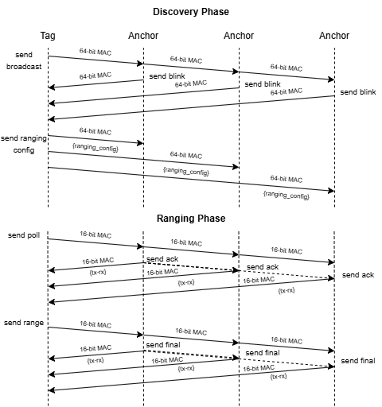
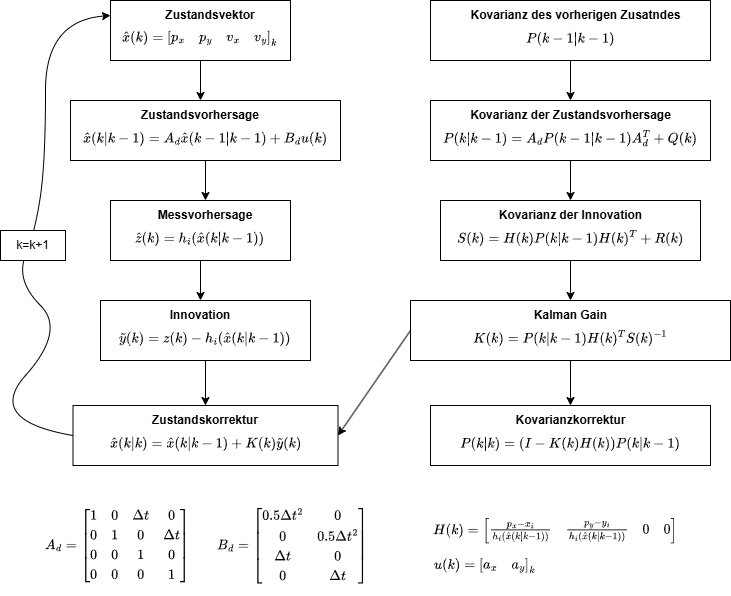

# UWB-IMU Sensor Fusion with an Extended Kalman Filter

Bachelor's thesis project on indoor positioning using UWB range measurements and IMU data. The repository contains ESP32 firmware, Python scripts for sensor fusion and analysis, and experimental recordings.

[Video of the line-of-sight experiment](https://youtu.be/Rbanm2skb94)

## Hardware

- ESP32 microcontrollers
- DW3000 UWB modules
- BNO085 IMU

## Method

The tag measures distances to UWB anchors using double-sided two-way ranging (DS-TWR). An Extended Kalman Filter (EKF) combines these measurements with IMU acceleration and orientation to estimate a two-dimensional position. The filter applies a zero-velocity update when the tag is stationary.

## Results

Position errors from the experiments are listed below. RMSE is the root mean square error; the 95th percentile is the error below which 95% of samples fall.

| Scenario | Algorithm | RMSE (m) | 95th percentile (m) |
| --- | --- | --- | --- |
| LOS (line of sight) | Trilateration | 0.078 | 0.139 |
| LOS (line of sight) | EKF | 0.056 | 0.086 |
| WLOS (one wall) | Trilateration | 0.520 | 0.858 |
| WLOS (one wall) | EKF | 0.518 | 0.817 |
| NLOS (heavily obstructed) | Trilateration | 0.608 | 0.967 |
| NLOS (heavily obstructed) | EKF | 0.219 | 0.330 |

The EKF reduced position error in the LOS and NLOS experiments. In the one-wall experiment, the range bias remained and the RMSE changed little.

## Repository structure

- `firmware/`: PlatformIO C++ project for the ESP32 tag, anchors, and debugger.
- [backend/](backend/README.md): Python scripts grouped into data collection, processing, analysis, and live visualization, with setup instructions and a script reference.
- [results/](results/README.md): Recorded CSV data, plots, and experiment-specific script variants, with file descriptions and analysis examples.
- `figures/`: Diagrams used in this README.

## License

The original project code is available under the [MIT License](LICENSE). Bundled third-party code, including `firmware/lib/Dw3000/`, retains its own license terms and copyright notices.
